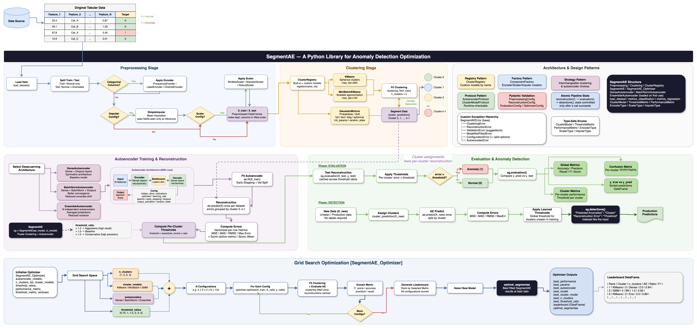

[![LinkedIn][linkedin-shield]][linkedin-url]
[![Contributors][contributors-shield]][contributors-url]
[![Stargazers][stars-shield]][stars-url]
[![MIT License][license-shield]][license-url]
[![Downloads][downloads-shield]][downloads-url]
[![Month Downloads][downloads-month-shield]][downloads-month-url]

[contributors-shield]: https://img.shields.io/github/contributors/TsLu1s/SegmentAE.svg?style=for-the-badge&logo=github&logoColor=white
[contributors-url]: https://github.com/TsLu1s/SegmentAE/graphs/contributors
[stars-shield]: https://img.shields.io/github/stars/TsLu1s/SegmentAE.svg?style=for-the-badge&logo=github&logoColor=white
[stars-url]: https://github.com/TsLu1s/SegmentAE/stargazers
[license-shield]: https://img.shields.io/github/license/TsLu1s/SegmentAE.svg?style=for-the-badge&logo=opensource&logoColor=white
[license-url]: https://github.com/TsLu1s/SegmentAE/blob/main/LICENSE
[linkedin-shield]: https://img.shields.io/badge/-LinkedIn-black.svg?style=for-the-badge&logo=linkedin&colorB=555
[linkedin-url]: https://www.linkedin.com/in/luisfssantos98/
[downloads-shield]: https://static.pepy.tech/personalized-badge/segmentae?period=total&units=international_system&left_color=grey&right_color=blue&left_text=Total%20Downloads
[downloads-url]: https://pepy.tech/project/segmentae
[downloads-month-shield]: https://static.pepy.tech/personalized-badge/segmentae?period=month&units=international_system&left_color=grey&right_color=blue&left_text=Month%20Downloads
[downloads-month-url]: https://pepy.tech/project/segmentae

## Framework Overview

`SegmentAE` is designed to enhance anomaly detection performance through the optimization of reconstruction error by integrating and intersecting clustering methods with tabular autoencoders. Built with enterprise-grade architecture, it provides a versatile, scalable, and robust solution for anomaly detection applications in domains such as financial fraud detection, network security, and industrial monitoring.

### Key Architectural Features (v2.0+)

-  **Professional Architecture**: Clean separation of concerns with robust principles
-  **Type Safety**: Comprehensive Pydantic validation and type hints throughout
-  **Design Patterns**: Registry, Strategy, and Template Method patterns
-  **Enum-Based Configuration**: Type-safe constants for all parameters
-  **Custom Exceptions**: Informative error messages with actionable suggestions

## Key Features and Capabilities

### 1. General Applicability on Tabular Datasets

SegmentAE is engineered to handle a wide range of tabular datasets, making it suitable for various anomaly detection tasks across different use case contexts. It can be seamlessly integrated into diverse applications, ensuring broad utility and adaptability.

### 2. Optimization and Customization

The framework offers complete configurability for each component of the anomaly detection pipeline, including:
- **Data Preprocessing**: Encoding, scaling, and imputation with Pydantic validation
- **Clustering Algorithms**: Registry-based clustering with easy extensibility
- **Autoencoder Integration**: Support for custom Keras/TensorFlow models or built-in implementations

Each component can be fine-tuned to achieve optimal performance tailored to specific use cases.

### 3. Enhanced Detection Performance

By leveraging a combination of clustering algorithms and advanced anomaly detection techniques, SegmentAE aims to improve the accuracy and reliability of anomaly detection. The integration of tabular autoencoders with clustering mechanisms ensures that the framework effectively captures and identifies different patterns in the input data, optimizing the reconstruction error for each cluster, thereby enhancing predictive performance.

## Main Development Tools

Major frameworks used to build this project:

* [TensorFlow](https://www.tensorflow.org/) 
* [Keras](https://keras.io/) 
* [Scikit-Learn](https://scikit-learn.org/stable/) 
* [Atlantic](https://pypi.org/project/atlantic/) 
* [Pydantic](https://docs.pydantic.dev/) 

## Where to Get It

Binary installer for the latest released version is available at the Python Package Index [(PyPI)](https://pypi.org/project/segmentae/).

GitHub Project Link: [https://github.com/TsLu1s/SegmentAE](https://github.com/TsLu1s/SegmentAE)

## Installation

To install this package from the PyPI repository, run the following command:

```bash
pip install segmentae
```

SegmentAE requires Python 3.10 or newer.

## SegmentAE - Technical Components and Pipeline Structure

<p align="center">
  <a href="https://raw.githubusercontent.com/TsLu1s/SegmentAE/main/docs/SegmentAE_Architecture_Final.drawio.png">
    
  </a>
</p>

<sub>Click the diagram to open it at full resolution. The editable source is <a href="https://github.com/TsLu1s/SegmentAE/blob/main/docs/SegmentAE_Architecture_Final.drawio">docs/SegmentAE_Architecture_Final.drawio</a>.</sub>


The SegmentAE framework consists of several integrated components, each playing a critical role in the optimization of anomaly detection through clustering and tabular autoencoders. The pipeline is structured with professional design patterns to ensure seamless data flow and modular customization.

### 1. Data Preprocessing

Proper preprocessing is crucial for ensuring the quality and consistency of data. The preprocessing module now includes:

- **Pydantic Validation**: Automatic type checking and conversion
- **Type-Safe Configuration**: Enum-based parameter selection
- **Missing Value Imputation**: Simple statistical imputation methods
- **Normalization**: MinMax, Standard, and Robust scaling options
- **Categorical Encoding**: Inverse Frequency, Label, and One-Hot Encoding
- **Index and Column Safe**: The index of your data is preserved (no need to reset it) and columns are validated against the ones seen during `fit`

**Example:**
```python
from segmentae import Preprocessing
from segmentae.core import EncoderType, ScalerType

# Type-safe configuration with enums
pr = Preprocessing(
    encoder=EncoderType.IFREQUENCY,  
    scaler=ScalerType.MINMAX,
    imputer="Simple"                # Strings also are supported
)
pr.fit(X_train)
X_transformed = pr.transform(X_test)
```

### 2. Clustering

Clustering forms the backbone of the SegmentAE framework, provided with easy extensibility:

- **Registry Pattern**: Clean model registration and instantiation
- **Type Safety**: Pydantic validation for all parameters
- **Three Algorithms**: K-Means, MiniBatch K-Means, Gaussian Mixture
- **Extensible Design**: Easy to add new clustering algorithms

**Example:**
```python
from segmentae import Clustering
from segmentae.core import ClusterModel

cl = Clustering(
    cluster_model=[ClusterModel.KMEANS],  # Enum-based ("KMeans" also works)
    n_clusters=3
)
cl.clustering_fit(X_train)
```

**Adding your own clustering algorithm:** subclass `AbstractClusterModel`, register it under a name, and use that name anywhere a cluster model is accepted (including the optimizer).

```python
from sklearn.cluster import Birch
from segmentae import Clustering, ClusterRegistry
from segmentae.core import AbstractClusterModel

class BirchCluster(AbstractClusterModel):
    def __init__(self, n_clusters=3, random_state=0):
        self._n_clusters, self._model = n_clusters, None

    def fit(self, X):
        self._validate_input(X, "Training data")
        self._model = Birch(n_clusters=self._n_clusters).fit(X)

    def predict(self, X):
        self._validate_fitted()
        return self._model.predict(X)

    def fit_predict(self, X):
        self.fit(X)
        return self.predict(X)

    @property
    def n_clusters(self):
        return self._n_clusters

    @property
    def is_fitted(self):
        return self._model is not None

ClusterRegistry.register("Birch", BirchCluster)
cl = Clustering(cluster_model=["Birch"], n_clusters=4)
```

### 3. Anomaly Detection - Autoencoders

The core of the SegmentAE framework employs advanced autoencoder architectures:

- **Three Baseline Implementations**: Dense, BatchNorm, and Ensemble autoencoders
- **Custom Model Support**: Integrate any Keras/TensorFlow model
- **Full Customization**: Network architecture, training epochs, activation layers, and more
- **Type-Safe Integration**: Validated through protocols (any object with a `predict(X)` method returning one reconstructed row per input row)

The framework includes three baseline autoencoder algorithms for user application, allowing complete customization of network architecture, training parameters, and activation functions.

> **Scaling and output activation:** the built-in autoencoders end in a `sigmoid` layer by default, which reconstructs values in `[0, 1]`. Pair it with `ScalerType.MINMAX`, or set `output_activation="linear"` when using `StandardScaler`/`RobustScaler`. A warning is raised at training time if the data falls outside the range the output layer can produce. Pass `random_state` for reproducible training.

**Custom Model Integration:**
You can build your own autoencoder model (Keras-based) and integrate it seamlessly into the SegmentAE pipeline → 
<a href="https://github.com/TsLu1s/SegmentAE/blob/main/examples/custom_autoencoders.py" style="text-decoration:none;">
    
</a>

**Unlabeled Data Support:**
Application example for totally unlabeled data available here → 
<a href="https://github.com/TsLu1s/SegmentAE/blob/main/examples/unlabeled_application.py" style="text-decoration:none;">
    
</a>

## SegmentAE - Predictive Application

The following example demonstrates the complete workflow from data loading to anomaly detection using a DenseAutoencoder integrated with KMeans clustering.

```python
import pandas as pd
from segmentae import SegmentAE, Preprocessing, Clustering
from segmentae.autoencoders import DenseAutoencoder
from segmentae.core import EncoderType, ScalerType, ClusterModel, ThresholdMetric
from segmentae.data_sources import load_dataset
from segmentae.metrics import metrics_classification
from sklearn.model_selection import train_test_split

############################################################################################
### Data Loading

train, test, target = load_dataset(
    dataset_selection='htru2_dataset',
    split_ratio=0.75
)

test, future_data = train_test_split(test, train_size=0.9, random_state=5)

# Resetting the index is optional: SegmentAE handles rows by position and
# returns results with the index of the data you pass in
train = train.reset_index(drop=True)
test = test.reset_index(drop=True)
future_data = future_data.reset_index(drop=True)

# Separate features and targets
X_train, y_train = train.drop(columns=[target]).copy(), train[target].astype(int)
X_test, y_test = test.drop(columns=[target]).copy(), test[target].astype(int)
X_future_data = future_data.drop(columns=[target]).copy()
y_future_data = future_data[target].astype(int)

############################################################################################
### Preprocessing with Type-Safe Configuration (v2.0+)

pr = Preprocessing(
    encoder=EncoderType.IFREQUENCY,  # Type-safe enum: EncoderType.LABEL, EncoderType.ONEHOT
    scaler=ScalerType.MINMAX,        # Type-safe enum: ScalerType.STANDARD, ScalerType.ROBUST
    imputer=None
)

pr.fit(X=X_train)
X_train = pr.transform(X=X_train)
X_test = pr.transform(X=X_test)
X_future_data = pr.transform(X=X_future_data)

############################################################################################
### Clustering Implementation with Type-Safe Registry

cl_model = Clustering(
    cluster_model=[ClusterModel.KMEANS],  # Type-safe enum: ClusterModel.MINIBATCH_KMEANS, ClusterModel.GMM
    n_clusters=3
)
cl_model.clustering_fit(X=X_train)

############################################################################################
### Autoencoder Implementation

denseAutoencoder = DenseAutoencoder(
    hidden_dims=[16, 12, 8, 4],
    encoder_activation='relu',
    decoder_activation='relu',
    output_activation='sigmoid',  # matches MinMax-scaled data; use 'linear' with StandardScaler
    optimizer='adam',
    learning_rate=0.001,
    epochs=150,
    val_size=0.15,
    stopping_patient=20,
    dropout_rate=0.1,
    batch_size=None,
    random_state=42               # reproducible training
)
denseAutoencoder.fit(input_data=X_train)
denseAutoencoder.summary()

############################################################################################
### Autoencoder + Clustering Integration

sg = SegmentAE(ae_model=denseAutoencoder, cl_model=cl_model)

############################################################################################
### Train Reconstruction with Type-Safe Metric (v2.0+)

sg.reconstruction(
    input_data=X_train,
    threshold_metric=ThresholdMetric.MSE  # Type-safe enum: ThresholdMetric.MAE, ThresholdMetric.RMSE, ThresholdMetric.MAX_ERROR
)

############################################################################################
### Reconstruction Performance Evaluation

results = sg.evaluation(
    input_data=X_test,
    target_col=y_test,
    threshold_ratio=2.0
)

# Access test metadata by cluster
preds_test, recon_metrics_test = sg.preds_test, sg.reconstruction_test

# View global metrics
print(results['global metrics'])
print(results['clusters metrics'])

############################################################################################
### Multiple Threshold Ratio Evaluation

threshold_ratios = [0.75, 1, 1.5, 2, 3, 4]

global_results = pd.concat([
    sg.evaluation(input_data=X_test, target_col=y_test, threshold_ratio=thr)["global metrics"]
    for thr in threshold_ratios
])

print("\nThreshold Optimization Results:")
print(global_results)

############################################################################################
### Anomaly Detection Predictions

best_ratio = global_results.sort_values(by="Accuracy", ascending=False).iloc[0]["Threshold Ratio"]

predictions = sg.detections(
    input_data=X_future_data,
    threshold_ratio=best_ratio
)

# Besides the reconstructed features, every row comes with its verdict and score
print(predictions[["Predicted Anomalies", "Cluster", "Reconstruction Error", "Threshold"]].head())

# Use the new metrics module for evaluation
final_metrics = metrics_classification(
    y_true=y_future_data,
    y_pred=predictions["Predicted Anomalies"]
)

print("\nFinal Performance Metrics:")
print(f"Accuracy: {final_metrics['Accuracy'].iloc[0]:.4f}")
print(f"Precision: {final_metrics['Precision'].iloc[0]:.4f}")
print(f"Recall: {final_metrics['Recall'].iloc[0]:.4f}")
print(f"F1 Score: {final_metrics['F1 Score'].iloc[0]:.4f}")
```

### Outputs at a Glance

- `sg.thresholds` — baseline threshold of each cluster (mean training reconstruction error); `sg.get_thresholds(ratio)` scales them by a threshold ratio.
- `sg.evaluation(...)` — dictionary with `"global metrics"`, `"clusters metrics"`, `"confusion matrix"` and `"y_true vs y_pred"`.
- `sg.detections(...)` — DataFrame indexed like the input, holding the reconstructed features plus `Predicted Anomalies`, `Cluster`, `Reconstruction Error` (the anomaly score) and `Threshold`.
- Samples assigned to a cluster that received no training samples are scored against the global training threshold (with a warning) instead of being dropped.

## Grid Search Optimizer

SegmentAE includes a comprehensive optimization methodology through the `SegmentAE_Optimizer` class to systematically identify optimal configurations.

The optimizer evaluates combinations of:
- Multiple autoencoders
- Different clustering algorithms  
- Various cluster numbers
- Different threshold ratios

**Example:**
```python
from segmentae.optimization import SegmentAE_Optimizer
from segmentae.core import ClusterModel

# Type-safe enum-based optimization 
optimizer = SegmentAE_Optimizer(
    autoencoder_models=[autoencoder1, autoencoder2],
    n_clusters_list=[2, 3, 4],
    cluster_models=[ClusterModel.KMEANS, ClusterModel.GMM, ClusterModel.MINIBATCH_KMEANS],  # Type-safe enums
    threshold_ratios=[1, 1.5, 2, 3],
    performance_metric='f1_score',  # or 'accuracy', 'precision', 'recall' (PerformanceMetric enum also works)
    threshold_metric='mse',         # or 'mae', 'rmse', 'max_error'
    verbose=True                    # set to False to silence progress output
)
# Note: Strings are also supported 
# cluster_models=["KMeans", "GMM", "MiniBatchKMeans"]

# Run grid search (X_valid / y_valid: labeled data used to select the configuration)
best_model = optimizer.optimize(X_train, X_valid, y_valid)

# View results
print(f"Best Performance: {optimizer.best_performance}")
print(f"Best Configuration: {optimizer.best_params}")
print("\nLeaderboard:")
print(optimizer.leaderboard.head(10))
```

> **Model selection note:** the best configuration is chosen on the labeled data passed to `optimize`, so `best_performance` is a validation score. Report final performance on a separate hold-out set that the search has not seen.

For a complete optimizer example → <a href="https://github.com/TsLu1s/SegmentAE/blob/main/examples/optimizer_application.py" style="text-decoration:none;">
    
</a>

## Template Example Applications

### 1. Basic Custom Model
Use your own Keras autoencoder with SegmentAE:
- **Example:** [custom_autoencoders.py](https://github.com/TsLu1s/SegmentAE/blob/main/examples/custom_autoencoders.py)
- Shows custom Sequential model integration
- Demonstrates multiple threshold evaluation

### 2. Baseline Autoencoders
Use built-in DenseAutoencoder or BatchNormAutoencoder:
- **Example:** [baseline_models.py](https://github.com/TsLu1s/SegmentAE/blob/main/examples/baseline_models.py)
- Shows built-in autoencoder usage
- Includes model summary and training visualization

### 3. Grid Search Optimization
Find optimal configuration automatically:
- **Example:** [optimizer_application.py](https://github.com/TsLu1s/SegmentAE/blob/main/examples/optimizer_application.py)
- Evaluates multiple autoencoders and clustering configs
- Multiple clustering algorithms
- Generates performance leaderboard

### 4. Unlabeled Data Detection
Detect anomalies without ground truth labels:
- **Example:** [unlabeled_application.py](https://github.com/TsLu1s/SegmentAE/blob/main/examples/unlabeled_application.py)
- Shows reconstruction-only workflow
- Useful for production deployment

## Interactive Notebooks

For a more interactive experience, feel free to explore the Jupyter notebooks with step-by-step execution and guidelines:

📓 **[Interactive Notebooks](https://github.com/TsLu1s/SegmentAE/tree/main/examples/notebooks)**

## Citation

If you use SegmentAE in your research, please cite:

```bibtex
@software{segmentae2024,
  author = {Luís Fernando Santos},
  title = {SegmentAE: A Python Library for Anomaly Detection Optimization},
  year = {2024},
  publisher = {PyPI},
  url = {https://pypi.org/project/segmentae/}
}
```

## License

Distributed under the MIT License. See [LICENSE](https://github.com/TsLu1s/SegmentAE/blob/main/LICENSE) for more information.

## Contact

Luis Santos - [LinkedIn](https://www.linkedin.com/in/luisfssantos98/)
